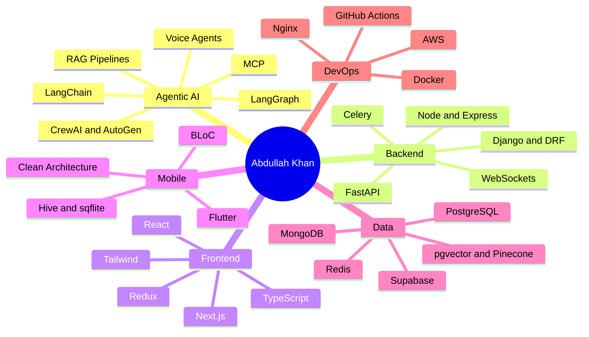

<div align="center">
  
</div>

<div align="center">

  <!-- Typing SVG -->
  <a href="https://git.io/typing-svg"></a>

</div>

<p align="center">
  
  
  
  
</p>

---

## 🚀 About Me

```python
class AbdullahKhan:
    def __init__(self):
        self.name = "Abdullah Khan"
        self.role = "Full-Stack AI Engineer"
        self.location = "Islamabad, Pakistan"
        self.company = "Vision Tact"
        self.education = "BS Computer Science, NUML (2023-2027)"
        self.certified = "IBM RAG & Agentic AI Professional Certificate"
        self.email = "abdullahkhitran2005@gmail.com"

    def expertise(self):
        return {
            "agentic_ai": ["RAG Pipelines", "LangChain", "LangGraph", "CrewAI", "AutoGen", "MCP"],
            "llms": ["OpenAI GPT-4o", "Anthropic Claude", "Google Gemini", "Groq"],
            "backend": ["FastAPI", "Django + DRF", "Node.js", "Express", "Celery", "WebSockets"],
            "frontend": ["React", "Next.js", "TypeScript", "Redux", "Tailwind CSS"],
            "mobile": ["Flutter", "Dart", "BLoC", "GetX", "Clean Architecture"],
            "voice_ai": ["Vapi", "Retell AI", "Twilio", "Deepgram", "ElevenLabs"],
            "databases": ["PostgreSQL", "MongoDB", "Redis", "Supabase", "pgvector", "Pinecone"],
            "devops": ["Docker", "AWS", "GitHub Actions", "Nginx", "CI/CD"],
        }

    def current_focus(self):
        return [
            "🤖 Building Agentic AI Systems with Human-in-the-Loop Safety",
            "🔍 Production RAG: Retrieval, Reranking & Grounded Answers",
            "🎙️ AI Voice Agents & Workflow Automation",
            "📱 Bringing AI Features to Mobile with Flutter",
        ]

abdullah = AbdullahKhan()
```

> 💬 *2+ years building production web apps, REST APIs and LLM-powered products, with hands-on ownership of Docker-based deployments and production support.*

---

## 💼 Tech Stack & Expertise

<div align="center">

### 🤖 AI, LLMs & Agents


### 🐍 Languages


### 🔧 Backend & APIs


### 🎨 Frontend


### 📱 Mobile & Desktop


`BLoC / Cubit` · `Provider` · `GetX` · `Clean Architecture` · `Hive` · `sqflite` · `Offline-First` · `Geofencing`

### 🗄️ Databases & Vector Stores


`pgvector` · `FAISS` · `Mongoose` · `SQLAlchemy`

### 🎙️ Voice AI & Automation


`Vapi` · `Retell AI` · `Deepgram STT` · `ElevenLabs TTS` · `Meta Marketing API` · `Google Ads API` · `Google Calendar API`

### 🚀 DevOps & Deployment


### 🛠️ Tools & Practices


</div>

---

## 🏢 Experience

<div align="center">

| Role | Company | Period | Highlights |
|------|---------|--------|------------|
| **Full-Stack AI Engineer** | Vision Tact, Islamabad | Apr 2026 – Present | Agentic workflows (LangChain/LangGraph) · RAG with citations · multi-provider LLM service layer · AI recruitment & interviews · Flutter apps · Docker + CI/CD |
| **Full-Stack Engineer** | Python Technologies, Islamabad | May 2025 – Mar 2026 | MERN apps · JWT/RBAC REST APIs · React + Redux dashboards · Flutter clients · MongoDB aggregation pipelines |

</div>

---

## 🎯 Current Projects & Focus

<div align="center">

| Project | What it does | Technologies | Status |
|---------|--------------|--------------|--------|
| 🧑‍💼 **PeopleSage** | Multi-tenant AI HR platform: candidate screening, AI-conducted interviews, payroll, attendance, performance & learning | FastAPI, Next.js, PostgreSQL, Redis, LangGraph, AWS | 🚀 Active |
| 🧠 **ARIC** | Voice-first multilingual AI companion with permanent semantic memory and human-approved actions across Notion, Gmail, Slack & MCP | FastAPI, Flutter, pgvector, Celery, LangGraph, MCP | 🚀 Active |
| 🏥 **AI Patient Acquisition** | Ad-to-appointment pipeline for UK & PK clinics: AI creatives, 24/7 voice booking agent, B2B outreach, referral portal | FastAPI, Next.js, Vapi/Retell, Twilio, n8n, Docker | 🚀 Active |
| 🎓 **ClassMind** | Academic management apps (admin + parent) on mobile & desktop; Gemini Flash turns messy Excel files into structured DB records | Flutter, BLoC, Clean Architecture, Supabase, Gemini | ✅ Built |
| 📚 **iLearn** | LLM assistant that turns student performance data into personalised study insights | FastAPI, Next.js, TypeScript | ✅ Built |

</div>

---

## 💡 Areas of Expertise

<div align="center">



</div>

---

## 📊 GitHub Statistics

<div align="center">
  
  
</div>

<div align="center">
  
</div>

<div align="center">
  
</div>

---

## 🏆 GitHub Trophies

<div align="center">
  
</div>

---

## 🌟 Featured Repositories

<!-- Replace with your best repos (and pin the same ones on your profile) -->
<div align="center">
  <a href="https://github.com/YOUR_GITHUB_USERNAME/REPO_NAME_1">
    
  </a>
  <a href="https://github.com/YOUR_GITHUB_USERNAME/REPO_NAME_2">
    
  </a>
</div>

---

## 🎓 Education & Certifications

- 🏅 **IBM RAG and Agentic AI Professional Certificate** (Coursera, 10 courses): RAG, vector databases, multimodal generative AI, LangChain/LangGraph agents, CrewAI/AutoGen/BeeAI multi-agent systems, MCP
- 🏅 **Mathematics for Machine Learning and Data Science Specialization** (DeepLearning.AI): linear algebra, calculus, probability & statistics
- 🏅 **Mobile App Development Certificate**, NAVTTC PM Youth Development Program (PMYDP), Batch 3
- 🎓 **BS Computer Science**, National University of Modern Languages (NUML), Islamabad, 2023–2027
- 🌐 **Languages:** English (Professional Working Proficiency), Urdu (Native)

---

## 📈 Coding Activity

<div align="center">
  
</div>

---

## 🤝 Connect With Me

<div align="center">

[](mailto:abdullahkhitran2005@gmail.com)
[](https://www.linkedin.com/in/abdullah-khan-845607362/)
[](https://abdullahKhetran.vercel.app/)

*Open to AI engineering opportunities and collaborations.*

</div>

---

## 💭 Dev Quote

<div align="center">
  
</div>

---

## 🐍 Contribution Snake: Multi-Theme Gallery

<div align="center">

### 🎨 Choose Your Favorite Animation! (Click to Explore All 10 Themes)

<details>
<summary><b>👉 View All Snake Themes 🌈</b></summary>

<br>

<table>
<tr>
<td align="center" width="50%">
<b>💜 Aurora Theme</b><br>

</td>
<td align="center" width="50%">
<b>✨ Neon Theme</b><br>

</td>
</tr>

<tr>
<td align="center" width="50%">
<b>🌅 Sunset Theme</b><br>

</td>
<td align="center" width="50%">
<b>🌊 Ocean Theme</b><br>

</td>
</tr>

<tr>
<td align="center" width="50%">
<b>💚 Matrix Theme</b><br>

</td>
<td align="center" width="50%">
<b>🔥 Fire Theme</b><br>

</td>
</tr>

<tr>
<td align="center" width="50%">
<b>❄️ Arctic Theme</b><br>

</td>
<td align="center" width="50%">
<b>🎆 Cyberpunk Theme</b><br>

</td>
</tr>

<tr>
<td align="center" width="50%">
<b>🖤 Dark Theme</b><br>

</td>
<td align="center" width="50%">
<b>⚪ Light Theme</b><br>

</td>
</tr>
</table>

</details>

### ⭐ Featured: Aurora Theme
<picture>
  <source media="(prefers-color-scheme: dark)" srcset="https://raw.githubusercontent.com/YOUR_GITHUB_USERNAME/YOUR_GITHUB_USERNAME/output/aurora.svg">
  <source media="(prefers-color-scheme: light)" srcset="https://raw.githubusercontent.com/YOUR_GITHUB_USERNAME/YOUR_GITHUB_USERNAME/output/github-snake.svg">
  
</picture>

<sub>💡 10 unique themes • Auto-updates every 12 hours • Click above to see all variants!</sub>

</div>

---

<div align="center">

### 💬 "Build things that make your future self say 😎"


</div>

---

<div align="center">
  <sub>⭐️ From <a href="https://github.com/YOUR_GITHUB_USERNAME">Abdullah Khan</a> | Last Updated: 2026</sub>
</div>
